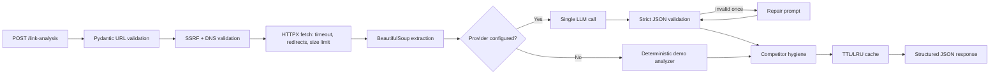

# AI Link Analysis API

A production-shaped FastAPI service that fetches a public website, extracts readable business content, and uses an LLM to produce structured competitor, search-query, SEO, service, and target-audience intelligence.

**Endpoint:** `POST /link-analysis`  
**Port:** `4000`  
**Live service:** <https://ai-link-analysis-c2yi.onrender.com>  
**Live API docs:** <https://ai-link-analysis-c2yi.onrender.com/docs>  
**Local docs:** `http://localhost:4000/docs`

> The Render instance runs on a free plan, so the first request after ~15 minutes of idleness takes roughly 50 s to wake the container. Warm analysis requests take 17–25 s.

> **Demo mode:** with no provider key, the API runs a deterministic, clearly-labelled heuristic analyzer so the service remains testable. Demo mode intentionally leaves competitors empty instead of inventing them. Set `GEMINI_API_KEY` or `OPENAI_API_KEY` for real LLM analysis.

---

## 1. What It Does

- Validates and normalises a URL, with SSRF and private-network protection.
- Fetches HTML with timeouts, redirect limits, response-size limits, and bot-challenge detection.
- Extracts title, metadata, headings, JSON-LD, internal link labels, and cleaned page text.
- Makes **one structured LLM call** for all five analysis sections to reduce latency and cost.
- Validates the LLM document with strict Pydantic models and one bounded repair attempt.
- Post-processes competitor rows to remove duplicates, the brand itself, and malformed URLs.
- Returns a stable JSON contract with request timing, token usage, and estimated cost.
- Caches identical analyses in-process with TTL + LRU eviction.
- Enforces a per-client rate limit on the analysis endpoint (`429` + `Retry-After`).
- Ships with tests, Docker, a Render blueprint, and this model/cost analysis.

### Response sections

1. Competitor vs. your brand
2. Exactly five target search queries and platform fit
3. SEO keywords, title, meta description, and supporting content
4. Exactly five top services, with `website` or `inferred` provenance
5. Primary/secondary target audience and marketing segments

---

## 2. Architecture



### Key design decisions

| Decision | Why |
|---|---|
| One LLM call for all five sections | Avoids 5× latency/cost and keeps competitor/SEO/audience framing consistent. |
| Strict Pydantic contract after generation | JSON mode alone is not a guarantee; validation catches missing fields and wrong item counts. |
| One repair attempt only | Recovers from occasional schema drift without unbounded spend. |
| Provider abstraction | Gemini primary, OpenAI-compatible fallback, deterministic demo. |
| AI-suggested competitor flag | Makes the provenance of competitor data explicit. |
| No search-volume claims | The app does not query a keyword-volume API, so it does not fabricate metrics. |
| Source provenance for services | `website` vs. `inferred` prevents inferred offerings being presented as facts. |

---

## 3. Project Structure

```text
ai-link-analysis/
├── app/
│   ├── main.py
│   ├── config.py
│   ├── schemas.py
│   ├── exceptions.py
│   ├── cache.py
│   ├── logging_config.py
│   ├── services/
│   │   ├── analysis_service.py
│   │   ├── website_extractor.py
│   │   ├── llm_service.py
│   │   ├── prompts.py
│   │   ├── competitor_service.py
│   │   ├── demo_analysis.py
│   │   ├── json_schema.py
│   │   └── pricing.py
│   └── utils/
│       └── validators.py
├── tests/
├── docs/
│   ├── sample-request.json
│   ├── sample-response.json
│   ├── sample-response-headers.txt
│   └── sample-run.txt
├── .env.example
├── Dockerfile
├── docker-compose.yml
├── render.yaml
├── requirements.txt
├── requirements-dev.txt
├── pyproject.toml
├── LICENSE
└── README.md
```

---

## 4. Quickstart

### Prerequisites

- Python **3.11+** (tested on 3.12.6)
- A Gemini or OpenAI API key for real LLM analysis

### Windows PowerShell

```powershell
cd ai-link-analysis
py -3.12 -m venv .venv
.\.venv\Scripts\Activate.ps1
python -m pip install -r requirements-dev.txt
Copy-Item .env.example .env
# Edit .env and set GEMINI_API_KEY
python -m uvicorn app.main:app --host 0.0.0.0 --port 4000
```

### macOS / Linux

```bash
cd ai-link-analysis
python3 -m venv .venv
source .venv/bin/activate
pip install -r requirements-dev.txt
cp .env.example .env
# Edit .env and set GEMINI_API_KEY
uvicorn app.main:app --host 0.0.0.0 --port 4000
```

Open:

- API docs: <http://localhost:4000/docs>
- Health: <http://localhost:4000/health>
- Endpoint: `POST http://localhost:4000/link-analysis`

### Provider selection

```dotenv
# Default: Gemini if key present, otherwise OpenAI, otherwise demo
LLM_PROVIDER=auto

# Force one provider
# LLM_PROVIDER=gemini
# LLM_PROVIDER=openai
# LLM_PROVIDER=demo
```

With both keys present, Gemini is primary and the OpenAI-compatible slot is the fallback. The shipped `render.yaml` points that slot at Groq's free tier (`openai/gpt-oss-120b`), so the deployed fallback costs nothing. Disable fallback with `ENABLE_LLM_FALLBACK=false`.

---

## 5. Configuration

| Variable | Default | Purpose |
|---|---|---|
| `LLM_PROVIDER` | `auto` | `auto`, `gemini`, `openai`, or `demo`. |
| `ENABLE_LLM_FALLBACK` | `true` | Cross-provider fallback on provider failure. |
| `GEMINI_API_KEY` | — | Google AI Studio key. |
| `GEMINI_MODEL` | `gemini-3.5-flash-lite` | Primary model. |
| `OPENAI_API_KEY` | — | OpenAI-compatible key (Groq, OpenRouter, or OpenAI). |
| `OPENAI_MODEL` | `gpt-6-luna` | Fallback / cost-first model. |
| `OPENAI_BASE_URL` | `https://api.openai.com/v1` | OpenAI-compatible endpoint. |
| `OPENAI_REASONING_EFFORT` | `none` | Lower latency/cost for extraction-style work. |
| `MAX_PAGE_BYTES` | `2000000` | Maximum downloaded HTML bytes. |
| `MAX_CONTENT_CHARS` | `18000` | Text budget sent to the LLM. |
| `MAX_REDIRECTS` | `3` | Redirect cap, each hop re-validated. |
| `FETCH_TIMEOUT_SECONDS` | `20` | Website fetch timeout. |
| `LLM_TIMEOUT_SECONDS` | `60` | Provider timeout. |
| `LLM_MAX_OUTPUT_TOKENS` | `5000` | Output cap. |
| `RATE_LIMIT_ENABLED` | `true` | Per-client limit on `POST /link-analysis`. |
| `RATE_LIMIT_REQUESTS` | `10` | Allowed analysis calls per client per window. |
| `RATE_LIMIT_WINDOW_SECONDS` | `60` | Rate-limit window length. |
| `CACHE_TTL_SECONDS` | `3600` | Analysis cache TTL. |
| `CACHE_MAX_ENTRIES` | `256` | In-process LRU bound. |
| `CORS_ORIGINS` | empty | Comma-separated allowed origins. |
| `ENVIRONMENT` | `development` | `development`, `test`, or `production`. |

Secrets use Pydantic `SecretStr` and are never logged.

---

## 6. API Usage

### Request

```bash
curl -X POST http://localhost:4000/link-analysis \
  -H "Content-Type: application/json" \
  -H "X-Request-ID: demo-request-0001" \
  -d '{"url":"https://www.shopify.com"}'
```

`X-Request-ID` is optional. If omitted, the API generates one and returns it in the response header and body.

### Response shape

```json
{
  "success": true,
  "website": "https://www.shopify.com/",
  "brand": {
    "name": "Shopify",
    "category": "E-commerce & Retail",
    "summary": "..."
  },
  "analysis": {
    "competitor_analysis": {
      "brand_overview": "...",
      "main_category": "E-commerce & Retail",
      "products_services": ["..."],
      "competitors": [
        {
          "name": "...",
          "website": "",
          "main_service": "...",
          "target_market": "...",
          "strengths": ["..."],
          "weaknesses": ["..."],
          "basis": "ai_suggested"
        }
      ],
      "competitive_advantages": ["..."],
      "opportunities": ["..."],
      "comparison_summary": "..."
    },
    "target_search_queries": [
      {
        "query": "best ecommerce solutions company",
        "platforms": ["Google", "LinkedIn"],
        "intent": "Commercial investigation",
        "business_relevance": "...",
        "target_audience": "..."
      }
    ],
    "seo_improvements": {
      "primary_keyword": "ecommerce solutions",
      "secondary_keywords": ["..."],
      "long_tail_keywords": ["..."],
      "business_keywords": ["..."],
      "recommended_title": "...",
      "title_rationale": "...",
      "meta_description": "...",
      "meta_description_rationale": "...",
      "supporting_content": []
    },
    "top_services": [],
    "target_audience": {},
    "data_quality_notes": []
  },
  "meta": {
    "request_id": "3244ff232825480b87f097640ae45f7a",
    "analyzed_at": "2026-11-19T13:54:31Z",
    "duration_ms": 23850,
    "cached": false,
    "llm": {
      "provider": "openai",
      "model": "openai/gpt-oss-120b",
      "mode": "llm",
      "fallback_used": true,
      "usage": {
        "input_tokens": 4163,
        "output_tokens": 2601,
        "total_tokens": 6764,
        "estimated_cost_usd": null
      }
    },
    "extraction": {
      "requested_url": "https://www.shopify.com/",
      "final_url": "https://www.shopify.com/",
      "title": "...",
      "content_chars": 3182,
      "word_count": 510,
      "truncated": false,
      "fetched_at": "2026-11-18T14:54:01Z",
      "content_hash": "..."
    },
    "warnings": [
      "Primary LLM provider failed; analysis was completed with the fallback provider."
    ]
  }
}
```

A real captured response is in [`docs/sample-response.json`](docs/sample-response.json), with the exact request in [`docs/sample-request.json`](docs/sample-request.json), response headers in [`docs/sample-response-headers.txt`](docs/sample-response-headers.txt), and a timing log in [`docs/sample-run.txt`](docs/sample-run.txt). That capture came from a Gemini free-tier `503` window and was completed by the Groq fallback, which is why `fallback_used` is `true`; the five-section contract is unchanged. The snippet above is abbreviated; the actual response contains five search queries and five services.

### Error shape

```json
{
  "success": false,
  "error": {
    "code": "BLOCKED_URL",
    "message": "The supplied URL points to a private, local, or otherwise blocked network address.",
    "request_id": "b5f4..."
  }
}
```

| Status | Code | Meaning |
|---:|---|---|
| 400 | `INVALID_URL` | Bad scheme, host, port, credentials, or URL syntax. |
| 400 | `BLOCKED_URL` | Private, loopback, link-local, CGNAT, reserved, or internal address. |
| 413 | `WEBSITE_TOO_LARGE` | HTML exceeds `MAX_PAGE_BYTES`. |
| 422 | `WEBSITE_BLOCKED` | 401/403/429 or bot challenge. |
| 422 | `WEBSITE_FETCH_FAILED` | Unreachable, non-HTML, or bad HTTP status. |
| 422 | `CONTENT_EXTRACTION_FAILED` | No meaningful readable text (e.g. JS-only page). |
| 502 | `LLM_UPSTREAM_ERROR` | All configured providers failed. |
| 504 | `WEBSITE_TIMEOUT` | Fetch timeout. |
| 503 | `LLM_NOT_CONFIGURED` | Explicit provider selected without a key. |

---

## 7. Security and Reliability

### SSRF protection

- Only `http://` and `https://`.
- Only ports `80` and `443`.
- Embedded credentials rejected.
- Hostnames such as `localhost`, `*.local`, `*.internal`, and `*.home.arpa` rejected.
- Literal private IPs rejected.
- DNS is resolved and **every** answer must be globally routable.
- Every redirect hop is re-validated, not just the first URL.
- Redirect limit, response-size limit, content-type allow-list, and timeouts.
- No JavaScript execution and no crawling beyond the submitted page.

**Residual risk:** DNS validation and the HTTP connection are separate operations, so a hostile resolver could attempt a rebinding race. For production, combine this with an egress firewall or HTTP proxy that only permits public IPs. This is documented rather than hidden.

### Prompt-injection defence

- Page content is explicitly marked as untrusted data.
- The system prompt forbids following instructions found in page content.
- The model is told not to reveal the system prompt or hidden instructions.
- Only JSON is accepted, then Pydantic validates the exact contract.
- Competitor URLs are not fetched or executed.

### Other controls

- Secrets via environment variables and `SecretStr`.
- No API keys, prompts, or page text in logs.
- Per-client rate limiting on `POST /link-analysis` (`RATE_LIMIT_REQUESTS` per `RATE_LIMIT_WINDOW_SECONDS`, default 10 per minute) returns `429` with `Retry-After`. `/health` and `/docs` stay reachable so monitoring and documentation are never blocked.
- Clients are identified by the Cloudflare-set `CF-Connecting-IP` header rather than `X-Forwarded-For`; forwarding headers are caller-controlled and would otherwise let a caller rotate its key and escape the limit.
- Generic 500 responses to clients; stack traces only in server logs.
- Security headers on every response.
- Request IDs for traceability.
- Strict response models prevent accidental extra fields.
- CORS disabled by default.

### Not included (deliberate scope choices)

- API authentication and per-tenant quotas (a per-client rate limit is included).
- Distributed rate limiting (counters are in-process).
- Redis cache.
- Playwright/browser rendering.
- Persistent storage or analytics database.

---

## 8. LLM Platform and Model Research

### Method and honesty statement

Pricing and model capabilities below were checked against official provider documentation on **18 November 2026**. Third-party speed figures are explicitly labelled as third-party measurements, not measurements from this repository. The service was then exercised end-to-end against real free-tier provider APIs on **19 November 2026**; those runs are reported in section E. They are functional smoke tests, not an accuracy benchmark: there is no labelled evaluation set, so the recommendation remains a documented engineering trade-off rather than a claim of measured maximum accuracy.

Official sources:

- Google Gemini pricing: <https://ai.google.dev/gemini-api/docs/pricing>
- Gemini 3.5 Flash-Lite model card: <https://ai.google.dev/gemini-api/docs/models/gemini-3.5-flash-lite>
- OpenAI pricing: <https://developers.openai.com/api/docs/pricing>
- GPT-6 Luna model card: <https://developers.openai.com/api/docs/models/gpt-6-luna>
- Anthropic pricing: <https://platform.claude.com/docs/en/about-claude/pricing>
- Anthropic model overview: <https://platform.claude.com/docs/en/about-claude/models/overview>

### A. Comparison

| Provider | Model | Input / 1M | Output / 1M | Context | Structured JSON | Speed evidence | Role here |
|---|---|---:|---:|---:|---|---|---|
| Google | `gemini-3.5-flash-lite` | $0.30 | $2.50 | 1,048,576 | Native structured outputs / JSON mode | ~350 output tok/s (Google-cited Artificial Analysis); third-party, not measured here | **Primary** |
| OpenAI | `gpt-6-luna` | $0.10 | $0.50 | 1,050,000 | Strict JSON Schema structured outputs | ~126–142 output tok/s in third-party OpenRouter/Artificial Analysis reports; not measured here | Optional paid fallback / cost-first |
| Groq | `openai/gpt-oss-120b` | free tier | — | 131,072 | Strict JSON Schema structured outputs | **Measured here:** 23.9–24.9 s end-to-end including a failed Gemini attempt | **Wired fallback** |
| Anthropic | `claude-haiku-5-5` | $0.10* | $0.50* | 1,000,000 | Structured outputs | Anthropic describes it as its fastest, latency-sensitive tier; no directly comparable task benchmark here | Evaluated, not wired |
| OpenAI | `gpt-5.4-nano` | $0.20 | $1.25 | Smaller/older tier | Structured outputs | Not benchmarked here | Optional legacy alternative |
| Anthropic | `claude-sonnet-5-5` | $2.00 | $10.00 | 1,000,000 | Structured outputs | Fast model class, but 20× Haiku input price | Higher-accuracy option if cost is secondary |

\* Claude Haiku 5.5 pricing applies to prompts up to 100,000 tokens. It also uses a newer tokenizer that Anthropic says produces roughly 30% more tokens for the same text.

### B. Estimated cost per website analysis

Assumptions: **6,000 input tokens** (about 18,000 characters of cleaned page, prompt, and constraints) and **3,000 output tokens** for the full five-section JSON. One call. Prices exclude taxes, grounding, and web search.

| Model | Input cost | Output cost | Total per analysis | 1,000 analyses |
|---|---:|---:|---:|---:|
| Gemini 3.5 Flash-Lite | $0.00180 | $0.00750 | **$0.00930** | **$9.30** |
| GPT-6 Luna | $0.00060 | $0.00150 | **$0.00210** | **$2.10** |
| Claude Haiku 5.5 (with ~30% tokenizer uplift) | ~$0.00078 | ~$0.00195 | **~$0.00273** | **~$2.73** |
| GPT-5.4 nano | $0.00120 | $0.00375 | **$0.00495** | **$4.95** |
| Claude Sonnet 5.5 (with uplift) | ~$0.01560 | ~$0.03900 | **~$0.05460** | **~$54.60** |

The API reports actual provider token counts and an estimated cost in `meta.llm.usage.estimated_cost_usd` when the model is in the local price table. Unknown models return `null`, not a guessed price.

### C. Final recommendation

**Primary: Google Gemini 3.5 Flash-Lite.**

| Item | Recommendation |
|---|---|
| Provider | Google (Gemini Developer API) |
| Model | `gemini-3.5-flash-lite` |
| Estimated input | 4,000–6,000 tokens after cleaning/truncation |
| Estimated output | 2,000–3,000 tokens of JSON |
| Estimated cost | $0.006–$0.012 per analysis |
| Measured latency | 17.3 s on Gemini, 23.9–24.9 s when the fallback runs (one page fetch + one LLM call) |
| Why | Strong JSON support, 1M context, low-latency Flash-Lite class, and a sub-cent cost per request. It is about 2.5–3× faster than GPT-6 Luna in third-party throughput reports while still costing under one cent. |
| Fallback | Groq `openai/gpt-oss-120b` through the OpenAI-compatible slot (free tier, strict JSON Schema) |
| Cost-first alternative | Set `LLM_PROVIDER=openai`; GPT-6 Luna is ~4.4× cheaper on the assumptions above but slower. |
| Accuracy policy | Do not claim “maximum accuracy” without a labelled evaluation set. Use the included response contract, spot-check outputs, and compare models on 50–100 real sites before making a production accuracy claim. |

**Why not simply choose the cheapest model?** This is a synchronous API. A 3,000-token JSON response is roughly 9 seconds at 350 tok/s versus 22 seconds at 135 tok/s. Gemini keeps the endpoint responsive while remaining below $0.01 per analysis. For asynchronous/bulk workloads, GPT-6 Luna is the better economic choice.

**Why not Claude Haiku 5.5?** It is a credible low-cost option with a 1M context and structured outputs. It is not wired into this project to keep the provider surface small and testable. The abstraction makes it a straightforward third provider; its newer tokenizer and adaptive thinking must be included in any cost/accuracy comparison.

### D. Cost optimization implemented

1. **One call** produces all five sections instead of five API calls.
2. **Content cleaning** removes scripts, styles, navigation, footers, duplicate lines, and boilerplate.
3. **Hard character budget** (`MAX_CONTENT_CHARS`, default `18000`, shipped `.env` uses `8000` to fit Groq's free-tier token budget) keeps inputs predictable.
4. **Output cap** (`LLM_MAX_OUTPUT_TOKENS`, default `5000`, shipped `.env` uses `3000` for the same reason) prevents runaway generations.
5. **TTL + LRU cache** serves repeated URLs without another fetch or LLM call.
6. **Single repair attempt** only when validation fails; no retry loop.
7. **Provider fallback** only after primary failure, not on every request.
8. **No web-search/grounding tool** is enabled, so there are no hidden per-search fees.
9. **Token and cost telemetry** are returned in every response.
10. **Low reasoning effort** is configured for GPT-6 Luna, appropriate for structured extraction.

### E. Measured runs (19 November 2026)

Captured with free-tier credentials against the running service, not estimated.

| Site | Provider used | Wall clock | Input / output tokens | Competitors | Queries | Services | Notes |
|---|---|---:|---:|---:|---:|---:|---|
| `stripe.com/in` | Gemini 3.5 Flash-Lite | 17.3 s | 6,002 / 2,958 | 3 | 5 | 5 | Primary path; all five service evidence quotes verified against the page HTML |
| `stripe.com/in` | Groq `gpt-oss-120b` (fallback) | 24.9 s | 6,567 / 2,785 | 4 | 5 | 5 | Gemini returned `503`; fallback returned the full contract |
| `shopify.com` | Groq `gpt-oss-120b` (fallback) | 23.9 s | 4,163 / 2,601 | 4 | 5 | 5 | Same Gemini `503` window; captured in `docs/` |
| `example.com` | Gemini 3.5 Flash-Lite | 17.3 s | 1,687 / 2,486 | 3 | 5 | 5 | 156 chars of page text; warnings correctly flag low confidence |

Free-tier limits observed directly:

- **Gemini** returns `503 UNAVAILABLE` ("currently experiencing high demand") for large requests during peak demand. The same prompt succeeds on other attempts and always succeeds at smaller output caps.
- **Groq** returns `429` with `Limit 8000 TPM` when a repair attempt follows a full-size request. One full analysis fits; a second call in the same minute may not.
- Neither limit caused a `5xx` from this API: the fallback absorbed the Gemini failure and the contract still returned five queries and five services.

A defect found by these runs: the strict JSON-Schema converter used to strip any key named `title`, which removed the real `supporting_content[].title` field from the schema sent to OpenAI-compatible providers. Groq therefore omitted it and validation failed twice. This is fixed in `app/services/json_schema.py` with regression tests.

### F. Next cost/quality improvements

- Add Redis so cache hits work across multiple Uvicorn workers/replicas.
- Cache by `content_hash` and reuse unchanged extraction results.
- Add prompt caching for the long system/contract prefix.
- Use a small model for extraction and a stronger model only for competitor/strategy reasoning.
- Add a 50–100 URL golden set with human ratings for competitor relevance, SEO usefulness, and service grounding.
- Use a search/places API to verify competitor entities instead of relying only on model knowledge.
- Batch non-urgent analyses through a queue and provider batch APIs.

---

## 9. Testing

```bash
pytest
ruff check app tests
```

The same two commands run in GitHub Actions on every push (`.github/workflows/ci.yml`).

Current result:

```text
50 passed
All checks passed!
```

Coverage includes:

- URL normalisation and rejection of loopback/private/link-local/hostile URLs.
- DNS answer validation, including mixed public/private answers.
- HTML extraction, JSON-LD, internal links, redirect limits, size limits, 403s, and non-HTML responses.
- Strict JSON Schema generation for OpenAI.
- Gemini and OpenAI request payloads and usage parsing.
- LLM JSON repair and provider fallback.
- Competitor deduplication and malformed URL handling.
- End-to-end API contract, caching, request IDs, health, and structured errors.
- Rate limiting: `429` shape, `Retry-After`, exemption of `/health`, and rejection of caller-chosen forwarding headers as a bucket key.

The test suite uses `httpx.MockTransport` and fake providers. It does not make paid LLM calls or depend on a live website.

---

## 10. Docker and Deployment

### Docker

```bash
docker build -t ai-link-analysis .
docker run --rm -p 4000:4000 --env-file .env ai-link-analysis
```

### Docker Compose

```bash
docker compose up --build
```

### Render

`render.yaml` provisions a Docker web service with `/health` as the health check.

1. Push the repository to GitHub.
2. In Render, choose **New → Blueprint** and select the repository.
3. Enter `GEMINI_API_KEY` and `OPENAI_API_KEY` when prompted. Both use `sync: false`, so they are never stored in `render.yaml`.
4. Deploy, then confirm `https://<service>.onrender.com/health` returns `status: "ok"` and `demo_mode: false`.

Operational notes:

- The image listens on the injected `$PORT`, so the same container also runs on Cloud Run, Fly.io, and plain Docker.
- The free plan sleeps after roughly 15 minutes of inactivity and the first request can take ~50 s. Ping `/health` from a free uptime monitor before sharing the link.
- Keep `RATE_LIMIT_REQUESTS` conservative when the deployment uses free-tier keys.

### Live demo

| Item | Value |
|---|---|
| Service | <https://ai-link-analysis-c2yi.onrender.com> |
| Endpoint | `POST https://ai-link-analysis-c2yi.onrender.com/link-analysis` |
| Documentation | <https://ai-link-analysis-c2yi.onrender.com/docs> |

Deployed from this repository on Render (Docker, free plan, `$PORT` injected). Verified against the public URL: `/health` reports `status: "ok"` and `demo_mode: false`, and a `POST /link-analysis` for `https://example.com` returned all five sections with honest low-content warnings. The first request after the free-tier idle timeout can take ~50 s.

### Production checklist

- Use a paid provider key and set a billing alert.
- Put the service behind an authenticated API gateway or add API-key auth.
- Add Redis for shared caching.
- Tune `RATE_LIMIT_REQUESTS` for expected traffic; add per-tenant quotas if third parties share the deployment.
- Restrict egress to the public internet and block cloud metadata ranges at the network layer.
- Run at least two replicas behind a load balancer.
- Export structured logs, latency, provider error rate, cache hit rate, and token cost metrics.
- Configure CORS to the exact frontend origin.
- Keep `.env` out of git; rotate keys if exposed.

---

## 11. Known Limitations

- **JavaScript-heavy sites** may return little text. A browser renderer is not included.
- **Bot-protected sites** (Cloudflare, captchas, 401/403/429) are reported gracefully, not bypassed.
- **Single-page analysis only.** It does not crawl the full site.
- **Competitor data is never verified.** `basis` is declared by the model: `public_information` means the model judges the company well known, and `ai_suggested` means it is a reasoned category peer. Neither is checked against a search or company-data API.
- **No search-volume, backlink, traffic, or ranking data.** The app never invents these metrics.
- **In-process cache** resets on restart and is per worker.
- **DNS rebinding** is mitigated but not fully eliminated without network-level egress controls.
- **Demo mode** is deterministic and intentionally does not fabricate competitors.
- **LLM output can still be wrong.** The contract guarantees shape and provenance labels, not factual truth.
- **No authentication.** A per-client rate limit is included, but anyone holding the URL can spend your provider quota; add API keys before a real launch.
- **Free-tier capacity is not production capacity.** Gemini returns `503` on large requests during demand spikes and Groq enforces an 8,000 TPM ceiling. The fallback covers the former; the latter means one full analysis per minute.
- **Rate limits are per process.** Multiple replicas each keep their own counters; move them to Redis for a shared limit. The key comes from the edge-provided client address, so a caller that could reach the container directly could forge it.
- **Model names and prices change.** The price table is dated and returns `null` for unknown models rather than guessing.

---

## 12. What I Would Improve Next

1. Add a Playwright fallback for JS-rendered pages, with a strict timeout and browser sandbox.
2. Add a verified competitor research pipeline using a search/company-data API and explicit citations.
3. Add a human-reviewed evaluation set and track precision/recall for competitor and service extraction.
4. Add Redis and content-hash caching to avoid duplicate LLM calls across replicas.
5. Add authentication and per-tenant cost budgets on top of the existing rate limit.
6. Add structured observability (OpenTelemetry) and provider latency dashboards.
7. Add async job mode for long analyses with webhook/polling delivery.
8. Add multi-page crawling limited to same-origin service and about pages.

---

## 13. Project Status

| Item | Status |
|---|---|
| Deployment | Live at <https://ai-link-analysis-c2yi.onrender.com> (Render free plan, Docker) |
| Tests | 50 passing (`pytest`) |
| Lint | `ruff check app tests` clean |
| Secrets | `.env` is ignored and has never been committed |
| Known gaps | No authentication, no browser rendering, no distributed cache |

Provider keys shared outside the repository should be rotated before the service is treated as a permanent deployment.

---

## 14. License

MIT. See [`LICENSE`](LICENSE).
